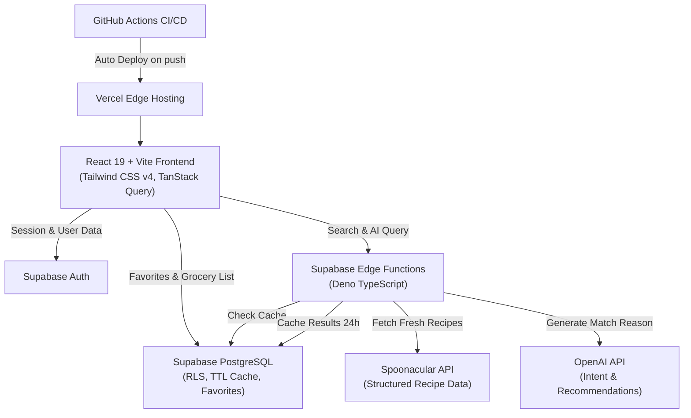

# CulinaAI 🍲

> **Think Ingredients. Discover Recipes.**  
> An intelligent recipe discovery platform that understands natural-language food requests, searches structured recipe data, recommends meals with AI, saves favourites, and creates consolidated grocery lists.

[](https://github.com/work-aditya/CulinaAI/actions/workflows/deploy.yml)
[](LICENSE)
[](https://react.dev)
[](https://vite.dev)
[](https://tailwindcss.com)
[](https://supabase.com)

---

## 📖 Overview

**CulinaAI** is a full-stack, interview-ready web application engineered to bridge the gap between abstract human cravings and actionable cooking. Instead of rigid keyword searches, CulinaAI uses natural-language query processing (NLP) and AI to parse intent, match available pantry ingredients, respect dietary restrictions, and generate consolidated shopping lists.

Designed with a warm, editorial food-tech aesthetic inspired by culinary publications:
- **Palette**: Warm linen background (`#FAF8F3`), olive rosemary (`#557A46`), warm apricot ochre (`#E6A45B`), and deep charcoal (`#24251F`).
- **Typography**: Editorial serif headings (*Fraunces*) paired with modern high-legibility sans-serif (*Plus Jakarta Sans*).
- **Zero layout shift**: Skeleton loaders and authentic culinary photography.

---

## ✨ Key Features

- 🧠 **Natural-Language Recipe Search**: Conversational food query interpretation (e.g. *"Quick 25-minute weeknight pasta with lots of garlic"*).
- 🥕 **Pantry & Ingredient Matcher**: Add available ingredients from your kitchen and instantly find recipes that utilize them.
- 🥗 **Dietary & Health Filters**: Filter by strict diets (Vegetarian, Vegan, Gluten-Free, Keto, Pescetarian), maximum cooking time, and calorie thresholds.
- ⚡ **Database-Backed API Caching**: PostgreSQL TTL caching table (`recipe_cache`) prevents redundant third-party API calls, drastically reducing Spoonacular quota consumption.
- 🤖 **AI Match Explanation**: Server-side LLM summaries explaining why each recipe matches the user's specific culinary intent.
- 📚 **Personal Recipe Cookbook**: Authenticated bookmarking with seamless sync between Supabase PostgreSQL and local storage fallback.
- 🛒 **Consolidated Grocery List**: Automatically aggregates and de-duplicates ingredients across multiple chosen recipes, grouped by supermarket aisle with one-click clipboard export.

---

## 🏗️ System Architecture



---

## 🛠️ Technology Stack

### Frontend
- **Framework**: React 19 + TypeScript
- **Build Tool**: Vite 8 with `@tailwindcss/vite`
- **Styling**: Tailwind CSS v4 (Theme tokens & custom editorial font variables)
- **Routing**: React Router DOM (v7)
- **Server State & Caching**: TanStack Query (React Query)
- **Icons & Animation**: Lucide React + Framer Motion
- **Forms & Validation**: React Hook Form + Zod

### Backend & Database
- **Platform**: Supabase Edge Functions (Deno + TypeScript)
- **Database**: PostgreSQL with Row Level Security (RLS) policies
- **Auth**: Supabase Auth (Email/Password & Session Management)
- **Caching**: PostgreSQL table with timestamp-based expiration (`expires_at`)

### External APIs
- **Spoonacular API**: Ingredient search, dietary filtering, recipe steps, and nutrition breakdown.
- **OpenAI API**: Natural language intent interpretation and contextual recipe explanations.

---

## 🚀 Getting Started

### Prerequisites
- Node.js (v20+ recommended)
- npm or pnpm
- (Optional) Supabase CLI & account for live cloud backend

### 1. Clone the Repository
```bash
git clone https://github.com/work-aditya/CulinaAI.git
cd CulinaAI
```

### 2. Install Dependencies
```bash
npm install
```

### 3. Environment Setup
Copy the example environment file:
```bash
cp .env.example .env.local
```
Configure your credentials in `.env.local`:
```env
VITE_SUPABASE_URL=https://your-project.supabase.co
VITE_SUPABASE_ANON_KEY=your-supabase-anon-key
```
*(Note: If left empty, CulinaAI automatically operates in local demo mode with curated culinary recipes and localStorage persistence).*

### 4. Run Development Server
```bash
npm run dev
```
Open [http://localhost:5173](http://localhost:5173) in your browser.

### 5. Build for Production
```bash
npm run build
```

---

## 🗄️ Database & Edge Functions Setup

### Apply Database Migrations
Run the SQL migration in `supabase/migrations/20261110000000_init_culina.sql` via the Supabase Dashboard SQL Editor or Supabase CLI:
```bash
supabase db push
```

### Deploy Supabase Edge Functions
Set your API secrets in Supabase:
```bash
supabase secrets set SPOONACULAR_API_KEY=your_spoonacular_key
supabase secrets set OPENAI_API_KEY=your_openai_key
```

Deploy the search function:
```bash
supabase functions deploy recipe-search
```

---

## 🚢 CI/CD & Deployment

This project includes an automated GitHub Actions CI/CD workflow located at [`.github/workflows/deploy.yml`](.github/workflows/deploy.yml) that deploys directly to Vercel on push to `main`.

### Required GitHub Secrets:
Add the following in your GitHub repository under **Settings → Secrets and variables → Actions**:
1. `VERCEL_TOKEN`: Vercel Personal Access Token
2. `VERCEL_ORG_ID`: Your Vercel Organization ID
3. `VERCEL_PROJECT_ID`: Your Vercel Project ID

---

## 📄 License

Distributed under the MIT License. See [LICENSE](LICENSE) for more information.
